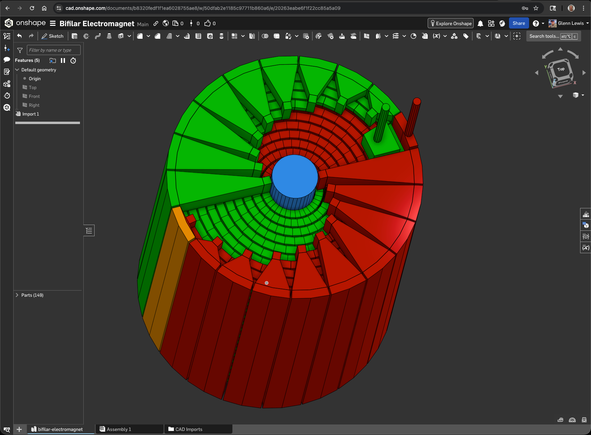

# gmlewis/step (MoonBit)

A high-level 3D modeling DSL and lossless STEP (ISO 10303-21) parser/serializer in MoonBit.

This repo allows you to build 3D models using a simple API and export them to valid,
topologically-sound STEP files.

Onshape design: https://cad.onshape.com/documents/b8320fedf1f1ea6028755ae8/w/50dfab2e1185c97711b860a6/e/20263eabe6f1f22cc85a5a09?renderMode=0&uiState=695414a99e93423471a30e60



*Example 12: The Bifilar Electromagnet, an invention of mine with interesting electrical properties.*

## Quick Start (Modeling)

Building a model is intuitive:

```moonbit
async fn main {
  let design = @cad.Design::new(name="my-model")
    .add(
      @cad.Cuboid::new(20, 20, 20)
        .with_name("base")
        .with_color(@cad.Rgb::orange())
    )
    .add(
      @cad.CalibrationChamferBlock::new(10, 10, 5, chamfer_size_mm=1.0)
        .with_name("top-part")
        .translate(z=20)
    )

  design.write_step(Some("model.step"))
}
```

## Quick previews (no built-in viewer)

The library writes files; it has no embedded viewer. For a fast look:

| Format | How | Notes |
|---|---|---|
| STEP | `./examples/run-example.sh 39 -o fits.step` | Exact B-Rep; opens in any CAD viewer or slicer. |
| STL | `./examples/run-example.sh 39 -o fits.step -stl` | OCCT tessellation; set `STL_DEFLECTION=<mm>` (default 0.05). |
| PNG | `./examples/run-example.sh 39 -o fits.step --png=preview.png` | Four views (iso/top/front/side); needs OCCT, macOS `sips`, and Inkscape (one view without it). |
| Blender | `./examples/run-example.sh 39 --blend model.blend` | Real booleans and an editable scene; see below. |
| glTF | `./examples/run-example.sh 39 --gltf fits.gltf` | Z-up JSON with an embedded buffer; opens in web/three.js glTF viewers. Written by the example itself. |

Run `./examples/run-example.sh --help` for all wrapper options, or
`./examples/run-example.sh 39 -- --help` for an example's own parameters.

## Exporting to Blender (Python)

This repo can generate Blender 5.0 Python scripts that recreate your model with correct physical scale. The generated script uses meters (Blender’s default), while your CAD dimensions remain in millimeters.

### From your own model
1. Implement your design in MoonBit (see the modeling example above).
2. Emit Blender Python instead of STEP:

```moonbit
design.write_blender_python(Some("model.py"))
```

3. Open Blender and run the script from the Scripting workspace, or run Blender directly from the command line:

```bash
blender --background --factory-startup --python model.py
```

### From the included examples
Generate Blender scripts and ".blend" files for all examples:

```bash
./scripts/manage_examples.py all --bpy
```

This produces `.py` and `.blend` files in [bpy-out](bpy-out).
Each script removes the default cube (if present), recreates the model, and selects all created geometry.

## Exporting to glTF

`Design::to_gltf()` writes a self-contained glTF 2.0 document (embedded base64
buffer) from the compiled B-Rep, with one mesh/primitive and material per
`SceneNode`. Coordinates are **Z-up** (the STEP convention); rotate the root
node by -90 degrees about X if your viewer assumes Y-up. Circular and
swept-curve bands are tessellated at 64 segments.

```moonbit
design.to_gltf_file(Some("model.gltf"))
```

From the included examples, pass `--gltf` (it replaces STEP output, like
`--blend`/`--bpy`):

```bash
./examples/run-example.sh 39 --gltf fits.gltf
```

The exporter tessellates `PLANE`, `CYLINDRICAL_SURFACE`, and
`SURFACE_OF_LINEAR_EXTRUSION` faces; any other surface aborts with an explicit
error rather than emitting an invalid mesh.

## Quick Start (Parsing)

Parsing from a string:

```moonbit
fn parse_example(step_text : String) -> Unit {
  match @parse.parse_repository_from_string_result(step_text) {
    @parse.ParseRepositoryResult::Ok(repo) => {
      let normalized = repo.to_step_file()
      println("entities=" + repo.len().to_string())
      println(normalized)
    }
    @parse.ParseRepositoryResult::Err(info) =>
      @cli.eprintln(@parse.format_step_parse_error(info))
  }
}
```

## Features

- **Fluent 3D DSL**: Chain transformations like `.translate()`, `.with_color()`, and `.with_name()`.
- **Lossless Roundtrips**: Unknown/unmodeled entities are preserved during parse/serialize cycles.
- **Robust CLI**: Built-in validation, proper `stderr` reporting, and short-circuiting exit codes.
- **Deterministic**: Serializer output is stable (parse → serialize → parse is idempotent).

### Booleans are nominal

In the STEP backend, `difference()` and `union_all()` are **nominal**: they
concatenate the faces of their children; they do not trim or subtract. The
resulting file still describes valid closed shells, but overlapping geometry is
not resolved. The Blender backend (`create_blender_file` /
`write_blender_python`) performs real boolean operations instead.

Use `Design::to_step_file_checked()` (or `write_step(..., checked=true)`) as the
recommended export entry point: it refuses to write a file when the design has
an error diagnostic, such as a boolean nested inside another boolean (those
children contribute no faces). `Design::diagnostics()` reports every nominal or
dropped boolean, and designs containing a nominal boolean carry a one-line
notice in the STEP header. `to_step_file()` and `write_step()` remain
unchecked for backward compatibility.

**The toolkit is not limited by this.** The STEP entity layer models real
boolean and CSG constructs — `BOOLEAN_RESULT` (`.UNION.`, `.INTERSECTION.`,
`.DIFFERENCE.`), `CSG_SOLID`, `CSG_SHAPE_REPRESENTATION`, `HALF_SPACE_SOLID`, and
the CSG primitives (`BLOCK`, `SPHERE`, `RIGHT_CIRCULAR_CYLINDER`,
`RIGHT_CIRCULAR_CONE`, `TORUS`, `RECTANGULAR_PYRAMID`, `RIGHT_ANGULAR_WEDGE`) —
and any data entity it does not recognize is preserved verbatim as `RawEntity`
through parse/serialize. So a file containing true booleans, complex surfaces,
or constructs the DSL does not model can still be represented and handed to a
full CAD kernel. The nominal caveat applies only to the convenience builders
`difference()` and `union_all()` in the `@cad` DSL.

`Design::to_csg_step()` / `write_csg_step()` emit the real boolean tree
(`CSG_SOLID` wrapping `BOOLEAN_RESULT` nodes) instead. OCCT's STEP reader cannot
consume that tree directly, so `scripts/csg_eval.py` evaluates it as a
development-time step: it extracts each leaf B-Rep, folds the tree with OCCT's
`bfuse`/`bcut`/`bcommon`, and writes a flat B-Rep that passes the full
validator. The library stays kernel-free; the script only needs `DRAWEXE` or
`occt-draw` installed:

- `python3 scripts/csg_eval.py part-csg.step -o part.step`

### Fits and clearances

`Fit` captures printed-hole clearance as intent instead of a hand-computed
number: `Nominal` (0.00 mm per face), `Close` (0.10), `Free` (0.25), and
`Press` (-0.05, interference). Clearance is per face, so the hole diameter
changes by `2 * per_face_mm()`; only voids grow.

```moonbit
let hole = @cad.Profile2D::hole_with_fit(5.0, fit=@cad.Fit::Free)
let plate = @cad.ExtrudedProfile::new(
  @cad.Profile2D::rect(40.0, 20.0),
  5.0,
  holes=[hole],
)
```

STEP export stays nominal: a fit changes the modelled void, not a printer
compensation layer. The values are a starting point for FDM printing, not a
universal standard.

## Development & Validation

### Verification
Run the unit tests and formatters:
- `./test-all.sh`

### STEP validation
`scripts/validate_step.py` is the compatibility gate. It checks ISO 10303-21
syntax (including the real-number grammar: upper-case `E`, mandatory decimal
point, no lower-case `e`), `#id` reference integrity, per-shell edge
usage/orientation, `PLANE`-face planarity, OCCT `checkshape`, and watertight
tessellation:

- `python3 scripts/validate_step.py part.step`
- `python3 scripts/validate_step.py --no-mesh part.step` (syntax/topology only)
- `python3 scripts/validate_step.py --gmsh part.step` (adds a second mesher)

`manage_examples.py --validate` runs the same gate for every generated
example. CI runs `manage_examples.py all --validate --no-mesh` on every push
and the tessellation gate daily.

### Geometric Validation & Rendering
We use Open CASCADE (`occt-draw` or `DRAWEXE`) to ensure topological validity and generate previews:
- `./scripts/manage_examples.py all --validate --render --readme`

### Fonts
Text examples use the `baloo` font from `gmlewis/fonts-b/baloo`. Its data is
vendored in `assets/fonts/baloo.json.gz` (SIL Open Font License 1.1; see
[assets/fonts/LICENSE-baloo.txt](assets/fonts/LICENSE-baloo.txt)), so the
examples work in a fresh checkout without any setup.

`@cad.load_font("name")` checks these paths in order:

1. `./assets/fonts/name.json.gz`
2. `./all-fonts/name.json.gz`
3. `$MOONBIT_STEP_ROOT/assets/fonts/name.json.gz`
4. `$MOONBIT_FONTS_DIR/all-fonts/name.json.gz`

To use another font, set `MOONBIT_FONTS_DIR` to a
[gmlewis/fonts](https://github.com/gmlewis/moonbit-fonts) checkout containing an
`all-fonts/` directory.

## Goals

- Provide a pleasant authoring UX for 3D models in MoonBit.
- Parse real-world STEP files without panicking.
- Provide actionable parse errors (line/col + statement snippets).

## License

Apache-2.0

## Status

The code has been updated to support compiler:

```bash
$ moon version --all
moon 0.1.20261016 (1af328f 2026-10-16) ~/.moon/bin/moon
moonc v0.10.16+b1a0e846e (2026-10-16) ~/.moon/bin/moonc
moonrun 0.1.20261016 (1af328f 2026-10-16) ~/.moon/bin/moonrun

```
