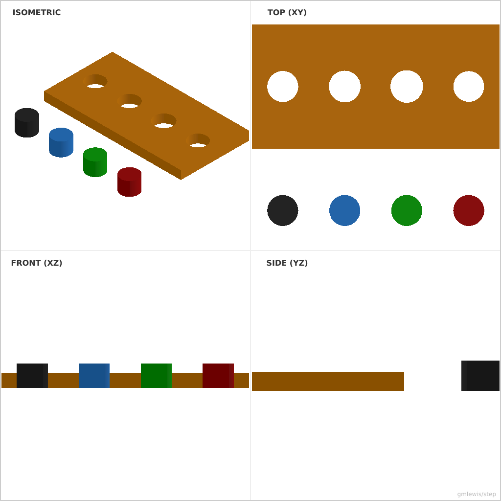
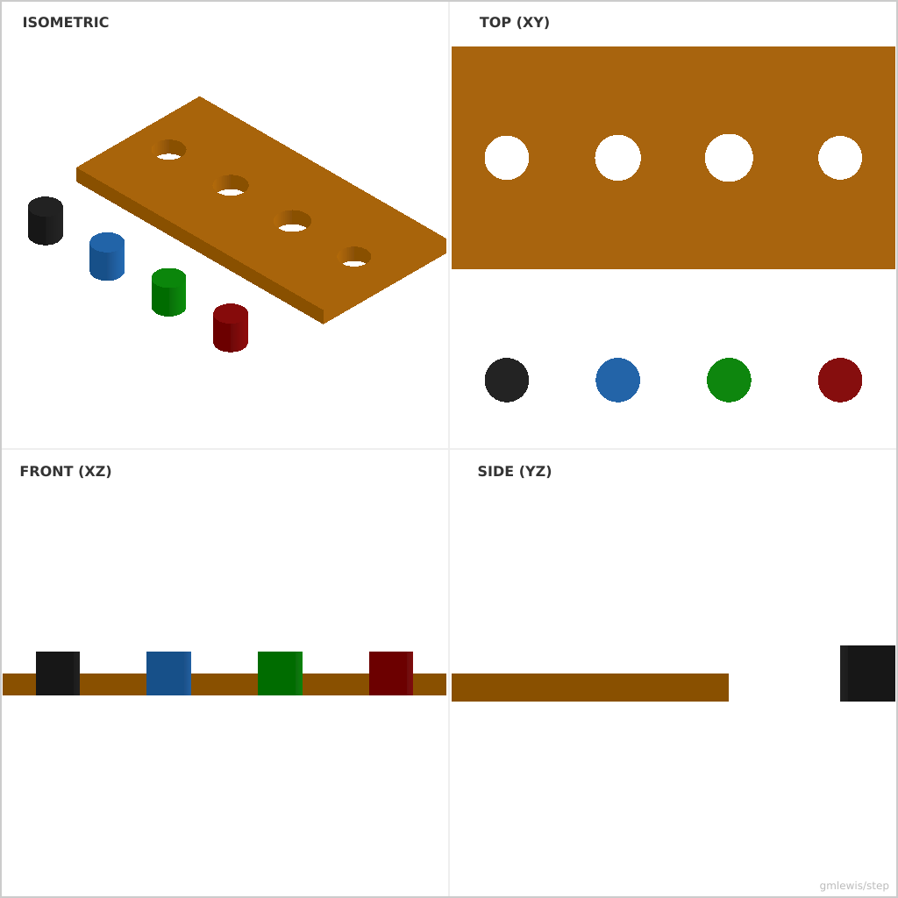

# 39 — Analytic Cylinders and Fits

This folder contains a **working example** that generates a STEP model for: a small gauge with analytic cylinder pegs and one hole per fit preset.

The intent is that you can run the code here to emit a STEP file, open it in a CAD viewer, and/or import it into your slicer to 3D print and iterate.

## What this example demonstrates
- analytic cylinder B-Rep (`CYLINDRICAL_SURFACE` plus two circular caps)
- fit-aware holes (`Nominal`, `Close`, `Free`, `Press`)
- checked STEP export (`write_step(..., checked=true)`)

## Parameters to try
- `diameter`
- `thickness`
- `pinHeight`
- `spacing`

## Suggested extensions
- add a second row with a stepped fit ladder
- replace the plate hole for `Press` with a boss and measure interference
- switch the pegs to `tube_with_fit` bores to inspect clearance directly

---

### Variant 1

Command line: `./run-example.sh 39 --diameter 10`

### Variant 2

Command line: `./run-example.sh 39 --diameter 6 --thickness 3 --pinHeight 6 --spacing 15`

