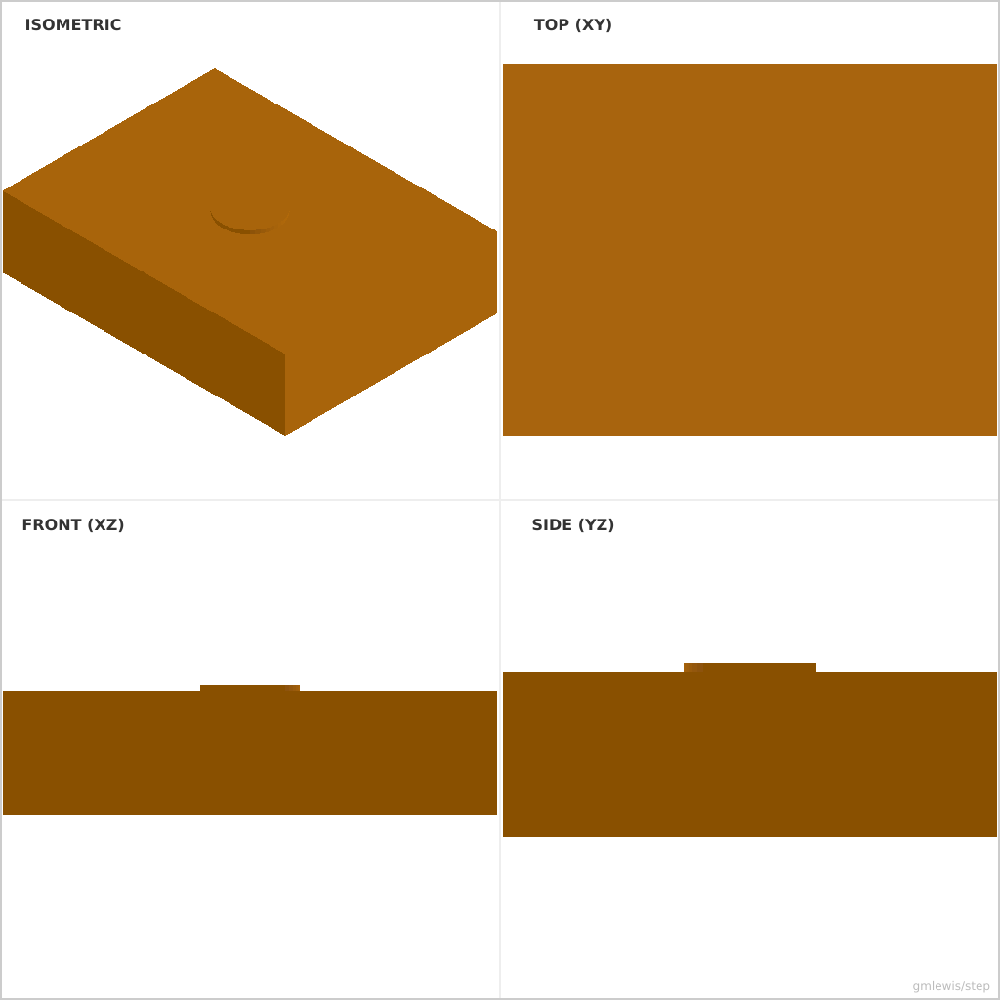
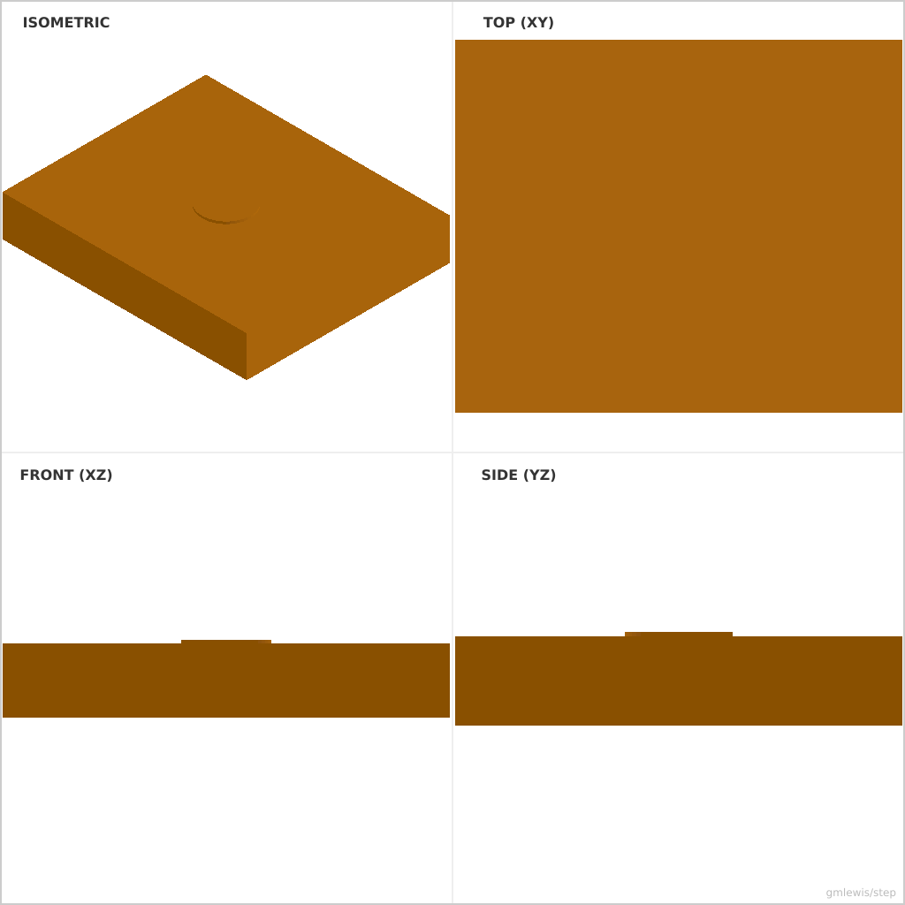

# 40 — Face Query Hole

This folder contains a **working example** that generates a STEP model for: a block whose top face is found by querying the compiled B-Rep, then a hole is cut centered on that face.

The intent is that you can run the code here to emit a STEP file, open it in a CAD viewer, and/or import it into your slicer to 3D print and iterate.

## What this example demonstrates
- `Design::planar_faces()` — discover the planar faces of a compiled solid
- `FaceSet::aligned_with(...).sort_by_z(...).first_matching(...)` — MakerCad-style face queries
- `cut_on_face(...)` — place a profile in the discovered face's frame and cut
- `--eval` — OCCT evaluates the boolean tree into a real, trimmed solid

## Parameters to try
- `--length` / `-l`, `--width` / `-w`, `--height`
- `--hole` / `-d`
- `--eval <path>` (write an OCCT-evaluated, really-trimmed STEP instead of the nominal one)

## Run

- From the `moonbit-step` root: `./examples/run-example.sh 40 -o block.step` (nominal STEP, hole faces concatenated)
- Real trimmed cut: `./examples/run-example.sh 40 --eval=hole.step --png=hole.png` (requires `occt-draw` or `DRAWEXE`)

## Suggested extensions
- cut two holes by querying both the top and a side face
- discover a cylindrical face and drill along its axis
- combine with `write_step_evaluated` in your own code instead of the CLI flag

---

### Variant 1

Command line: `./run-example.sh 40 `

### Variant 2

Command line: `./run-example.sh 40 --hole 12 --length 60 --width 50`

