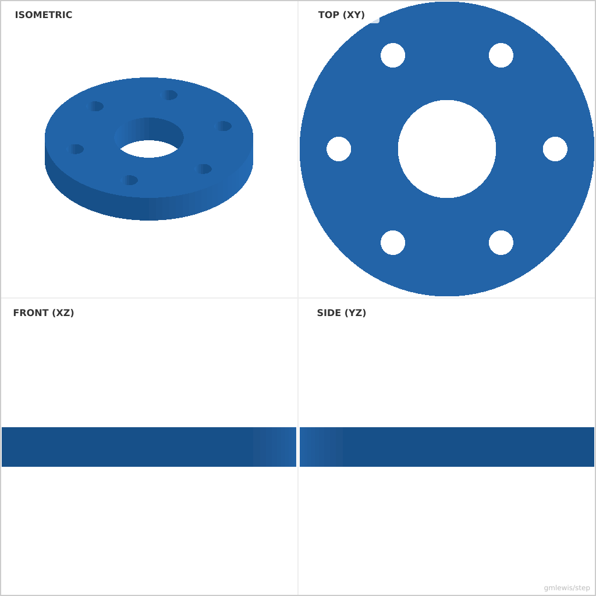

# 41 — Flange Bolt Circle

This folder contains a **working example** that generates a STEP model for: a round flange with a central bore and a bolt circle of holes, built entirely from deterministic `Profile2D` helpers.

The intent is that you can run the code here to emit a STEP file, open it in a CAD viewer, and/or import it into your slicer to 3D print and iterate.

## What this example demonstrates
- deterministic constraint helpers: `bolt_circle`, `with_hole_at`, `with_bolt_circle` (no solver runs at export time)
- `Profile2D` holes with optional `Fit` clearance growth
- exporting a clean STEP solid you can reuse in other tools

## Parameters to try
- `--diameter` / `-d`, `--bore` / `-b`, `--bolt-circle`, `--bolts` / `-n`, `--bolt-hole`, `--thickness` / `-t`

## Run

- From the `moonbit-step` root: `./examples/run-example.sh 41 -o flange.step`

## Suggested extensions
- use `fit=@cad.Fit::Free` on the bolt holes for FDM printing
- swap `with_bolt_circle` for `with_grid_of_holes` on a rectangular plate
- add a `tangent_rect` outline instead of a circle

---

### Variant 1

Command line: `./run-example.sh 41 `

### Variant 2

Command line: `./run-example.sh 41 --diameter 80 --bolts 8 --bolt-circle 30 --thickness 10`

